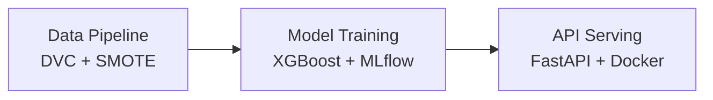

# FraudGuard — Financial Fraud Detection System

An end-to-end machine learning pipeline for detecting financial fraud in real-time using XGBoost, FastAPI, Docker, MLflow, and DVC.

## What This Project Does

- Built a fraud detection model in Python on 6.3 million financial transactions, using XGBoost to classify each transaction as fraud or legitimate.
- Handled a highly imbalanced dataset with only 0.13% fraud cases by applying SMOTE on the training data alone, keeping 1.27 million test records untouched, and created 5 new features from account balances and transaction amounts (balance change, amount-to-balance ratio), raising model inputs to 16.
- Achieved a 0.95 F1-score and 99.8% recall, correctly catching 1,640 out of 1,643 fraud cases in the test set.
- Developed a REST API using FastAPI that returns an Approve or Block decision and generates a 3-sentence investigation report for each transaction using the Llama 3.2 language model.
- Streamlined experiment tracking by integrating MLflow and DVC, ensuring precise version control for a 500MB+ dataset and fully reproducible model training.

## Project Architecture



## Tech Stack

- **Machine Learning**: Python, XGBoost, Scikit-learn, Imbalanced-learn (SMOTE)
- **MLOps & Tracking**: MLflow, DVC
- **API & Serving**: FastAPI, Uvicorn, Docker
- **Monitoring**: Prometheus, Grafana
- **Explainability**: SHAP, Ollama (Llama 3.2)

## Dataset

PaySim synthetic financial dataset (6.3M transactions, 0.13% fraud rate).  
Download from [Kaggle](https://www.kaggle.com/datasets/ealaxi/paysim1) and place the CSV in `data/raw/`.

## Quick Start

### 1. Install Dependencies
```bash
pip install -r requirements.txt
```

### 2. Run the Pipeline
```bash
# Preprocess data (applies SMOTE, creates features)
python src/preprocess.py --input data/raw/PS_20174392719_1491204439457_log.csv --output data/processed/

# Train the model (logs to MLflow)
python src/train.py --data-dir data/processed/ --model-dir models/

# Evaluate the model
python src/evaluate.py --model models/xgboost_fraud.joblib --data-dir data/processed/
```

### 3. Start the API
```bash
uvicorn src.predict:app --host 0.0.0.0 --port 8000
```

### 4. Docker
```bash
docker-compose up --build
```

### 5. Test a Prediction
```bash
curl -X POST http://localhost:8000/predict \
  -H "Content-Type: application/json" \
  -d '{
    "step": 1,
    "type": "TRANSFER",
    "amount": 181000.0,
    "oldbalanceOrg": 181000.0,
    "newbalanceOrig": 0.0,
    "oldbalanceDest": 0.0,
    "newbalanceDest": 0.0
  }'
```

## DVC Pipeline

```bash
dvc repro       # Run the full pipeline
dvc dag         # View pipeline DAG
dvc metrics show  # View metrics
```

## Project Structure

```
mlops-fraud-detection/
├── src/
│   ├── preprocess.py      # Data cleaning, feature engineering, SMOTE
│   ├── train.py           # XGBoost training with MLflow logging
│   ├── evaluate.py        # Model evaluation and threshold tuning
│   ├── predict.py         # FastAPI inference server
│   ├── explain.py         # SHAP + LLM explainability
│   └── drift.py           # Data drift detection with Evidently
├── data/
│   └── raw/               # Raw PaySim CSV (tracked by DVC)
├── models/                # Trained model artifacts
├── reports/               # Evaluation plots and reports
├── monitoring/
│   ├── prometheus/        # Prometheus config
│   └── grafana/           # Grafana dashboards
├── tests/                 # Unit tests
├── Dockerfile
├── docker-compose.yml
├── dvc.yaml               # DVC pipeline definition
├── requirements.txt
└── metrics.json           # Model performance metrics
```

## Model Performance

| Metric | Score |
|--------|-------|
| F1-Score | 0.95 |
| Recall | 99.8% |
| Precision | 90.7% |
| ROC AUC | 0.999 |
| Fraud Cases Caught | 1,640 / 1,643 |

## License

MIT
