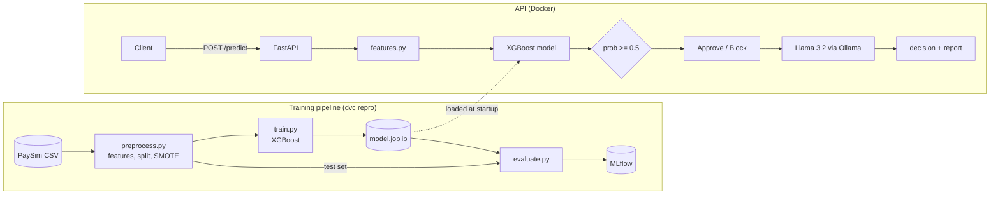

# FraudGuard - Financial Fraud Detection System

FraudGuard classifies financial transactions as fraud or legitimate using XGBoost, trained on 6.3 million transactions. It's served through a FastAPI endpoint that returns an **Approve / Block** decision along with a short investigation report written by Llama 3.2.

**Stack:** Python, Pandas, Scikit-learn, imbalanced-learn, XGBoost, FastAPI, Ollama (Llama 3.2), Docker, DVC, MLflow

## Problem Statement

In mobile money and online banking, a common fraud pattern is account takeover. The fraudster gets into an account, transfers the full balance to another account, and cashes it out.

Catching this with ML is harder than it sounds:

- Fraud is extremely rare. Only 0.13% of transactions in this dataset are fraud, so a model that predicts "legit" every time gets 99.87% accuracy and is useless. Accuracy can't be the metric.
- Missing a fraud costs much more than a false alarm. A blocked genuine payment means a verification call. A missed fraud means the money is gone. So the priority is high recall on the fraud class, with precision kept reasonable.
- A probability score on its own isn't enough for the person reviewing the case. They need a quick explanation of why the transaction was flagged.

## Dataset

[PaySim](https://www.kaggle.com/datasets/ealaxi/paysim1) is a synthetic dataset generated from real mobile money logs. It has 6,362,620 transactions, of which 8,213 (0.13%) are fraud. Each row has the transaction type, the amount, and the sender's and receiver's balances before and after the transaction.

While exploring the data I found that fraud only appears in `TRANSFER` and `CASH_OUT` transactions, and that the sender's account is usually emptied completely. Most of the engineered features come from that observation.

The CSV is about 470 MB, so it isn't committed. Download it and place it in `data/raw/`.

## Approach

**Features (16 inputs).** I drop the account ID columns, keep the 6 numeric columns, and one-hot encode the transaction type into 5 columns. On top of these I add 5 new features from the balances and amounts:

- `balance_diff_orig`: how much actually left the sender's account
- `balance_diff_dest`: how much actually reached the receiver
- `amount_ratio`: amount divided by the sender's balance (close to 1 means the account was drained)
- `is_orig_balance_zero`: whether the sender was left with 0
- `is_dest_balance_zero`: whether the receiver's balance is 0 after the transfer

Training and the API both build features with the same function (`src/features.py`), so the model sees exactly the same inputs in both places.

**Class imbalance.** I do an 80/20 stratified split first. Then I apply SMOTE to the training set only, bringing fraud up to 10% of the non-fraud count. The test set (1,272,524 rows, 1,643 fraud cases) is never resampled. Running SMOTE before the split would leak synthetic copies of test rows into training and inflate the scores.

**Model.** XGBoost with 200 trees, max depth 6 and `scale_pos_weight` for the remaining imbalance. Tree models fit well here: the data is tabular, the important signals are thresholds (like a balance hitting exactly 0), and inference takes milliseconds.

**Investigation report.** For every transaction the API asks Llama 3.2, running locally through Ollama, for a 3-sentence report covering the risk level, the reason, and the next step for the analyst. Llama 3.2 is a small 3B model, and early versions got the arithmetic wrong and sometimes contradicted the model's decision. So now the code computes the facts (risk level, share of the balance moved, whether the account was emptied) and the LLM only phrases them. If Ollama isn't running, the API falls back to a template report.

**Tracking.** The pipeline is defined in `dvc.yaml` (preprocess -> train -> evaluate), so `dvc repro` rebuilds everything and skips stages that haven't changed. Each evaluation is logged to MLflow with its parameters, metrics and plots, which makes it easy to compare experiments.

## Results

These are the scores on the untouched test set of 1,272,524 transactions:

| Metric (fraud class) | Score |
|---|---|
| F1-score | 0.95 |
| Recall | 99.8% |
| Precision | 0.91 |
| Fraud caught | 1,640 / 1,643 |

The full report is in [reports/classification_report.txt](reports/classification_report.txt). The model misses 3 fraud cases out of 1,643. The trade-off is that about 1 in 10 blocked transactions is genuine, which is usually acceptable for a bank since a verification call costs far less than a successful fraud.

## Architecture



## Project Structure

```
├── src/
│   ├── config.py        # paths, feature list, threshold
│   ├── features.py      # feature engineering (shared by training and API)
│   ├── preprocess.py    # load data, split, SMOTE
│   ├── train.py         # train XGBoost
│   ├── evaluate.py      # test metrics, plots, MLflow logging
│   ├── report.py        # Llama 3.2 investigation report
│   └── api.py           # FastAPI app
├── tests/
├── models/xgboost_fraud.joblib
├── reports/classification_report.txt
├── dvc.yaml
├── Dockerfile
├── docker-compose.yml
└── requirements.txt
```

## Running it

```bash
git clone https://github.com/Saksham2410del/mlops-fraud-detection.git
cd mlops-fraud-detection
pip install -r requirements.txt
```

**Start the API.** The trained model is already in `models/`.

```bash
ollama pull llama3.2
uvicorn src.api:app --reload
```

Send a test transaction:

```bash
curl -X POST http://localhost:8000/predict \
  -H "Content-Type: application/json" \
  -d '{"step":1,"type":"TRANSFER","amount":181000,"oldbalanceOrg":181000,"newbalanceOrig":0,"oldbalanceDest":0,"newbalanceDest":0}'
```

```json
{
  "decision": "Block",
  "fraud_probability": 1.0,
  "investigation_report": "The risk level is high and the decision is to block the transaction. ...",
  "report_source": "llama3.2",
  "model_latency_ms": 22.29
}
```

Interactive API docs are at `http://localhost:8000/docs`.

**Retrain** (after putting the PaySim CSV in `data/raw/`):

```bash
dvc repro
mlflow ui --backend-store-uri sqlite:///mlflow.db
```

**Docker:**

```bash
docker compose up --build
docker compose exec ollama ollama pull llama3.2
```

**Tests:**

```bash
pytest
```

## Limitations and next steps

- PaySim is synthetic, so scores on real bank data would likely be lower.
- The model looks at one transaction at a time. Features based on customer history, like the number of transfers in the last hour, would help catch subtler fraud.
- The 0.5 threshold could be tuned based on the actual cost of a missed fraud versus a false alarm.
- The report adds a few seconds per request on CPU. In production it could be generated only for blocked transactions, in the background.
