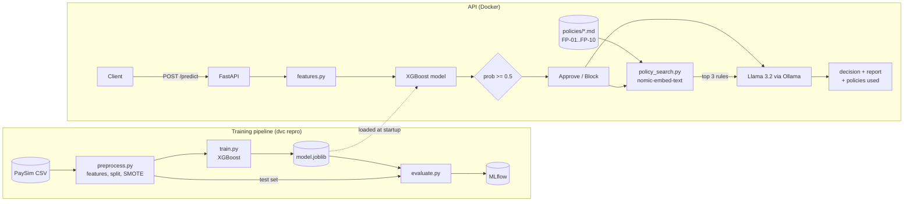

# FraudGuard - Financial Fraud Detection System

FraudGuard classifies financial transactions as fraud or legitimate using XGBoost, trained on 6.3 million transactions. It's served through a FastAPI endpoint that returns an **Approve / Block** decision along with a short investigation report written by Llama 3.2. The report is grounded in the bank's fraud policy documents using RAG, so the recommended next step comes from policy and not from the LLM's memory.

**Stack:** Python, Pandas, Scikit-learn, imbalanced-learn, XGBoost, FastAPI, Ollama (Llama 3.2, nomic-embed-text), RAG, Docker, DVC, MLflow

## Problem Statement

In mobile money and online banking, a common fraud pattern is account takeover. The fraudster gets into an account, transfers the full balance to another account, and cashes it out.

Catching this with ML is harder than it sounds:

- Fraud is extremely rare. Only 0.13% of transactions in this dataset are fraud, so a model that predicts "legit" every time gets 99.87% accuracy and is useless. Accuracy can't be the metric.
- Missing a fraud costs much more than a false alarm. A blocked genuine payment means a verification call. A missed fraud means the money is gone. So the priority is high recall on the fraud class, with precision kept reasonable.
- A probability score on its own isn't enough for the person reviewing the case. They need a quick explanation of why the transaction was flagged, and what the bank's procedure says to do next.

## Dataset

[PaySim](https://www.kaggle.com/datasets/ealaxi/paysim1) is a synthetic dataset generated from real mobile money logs. It has 6,362,620 transactions, of which 8,213 (0.13%) are fraud. Each row has the transaction type, the amount, and the sender's and receiver's balances before and after the transaction.

While exploring the data I found that fraud only appears in `TRANSFER` and `CASH_OUT` transactions, and that the sender's account is usually emptied completely. Most of the engineered features come from that observation.

The CSV is about 470 MB, so it isn't committed. Download it and place it in `data/raw/`.

## Approach

**Features (16 inputs).** I drop the account ID columns, keep the 6 numeric columns, and one-hot encode the transaction type into 5 columns. On top of these I add 5 new features from the balances and amounts:

- `balance_diff_orig`: how much actually left the sender's account
- `balance_diff_dest`: how much actually reached the receiver
- `amount_ratio`: amount divided by the sender's balance (close to 1 means the account was drained)
- `is_orig_balance_zero`: whether the sender was left with 0
- `is_dest_balance_zero`: whether the receiver's balance is 0 after the transfer

Training and the API both build features with the same function (`src/features.py`), so the model sees exactly the same inputs in both places.

**Class imbalance.** I do an 80/20 stratified split first. Then I apply SMOTE to the training set only, bringing fraud up to 10% of the non-fraud count. The test set (1,272,524 rows, 1,643 fraud cases) is never resampled. Running SMOTE before the split would leak synthetic copies of test rows into training and inflate the scores.

**Model.** XGBoost with 200 trees, max depth 6 and `scale_pos_weight` for the remaining imbalance. Tree models fit well here: the data is tabular, the important signals are thresholds (like a balance hitting exactly 0), and inference takes milliseconds.

**Investigation report (RAG).** XGBoost makes the decision, and Llama 3.2 explains it in 3 sentences: the risk level, the facts behind it, and the next step for the analyst. Analysts at a bank follow written procedures, so the next step has to come from policy, not from whatever the LLM happens to suggest. The `policies/` folder holds 10 sample fraud rules (FP-01 to FP-10), for example holding a transfer that drains an account, flagging possible mule accounts, high value review, and customer liability timelines. These are sample policies written for this project, loosely based on common banking practice and RBI's guidance on unauthorised electronic transactions.

For each transaction:

1. `report.py` describes the transaction in plain English, for example "A large TRANSFER. It moved the entire balance out of the sender's account, leaving it at zero. The fraud model blocked it."
2. `policy_search.py` embeds that description with `nomic-embed-text` (through Ollama) and compares it with the embeddings of all 10 rules using cosine similarity. The top 3 rules are returned.
3. The rules are added to the Llama 3.2 prompt, and the model has to pick one and cite it ("Per FP-01, ..."). The API response also lists the rule IDs in `policies_used`.

With only 10 rules, the embeddings sit in a NumPy array that's built once on the first request, so there's no need for a vector database.

A few things were needed to make a small 3B model reliable here:

- **Code computes the facts.** The model kept getting arithmetic wrong, so the code works out the risk level, the share of the balance moved, and whether the account was emptied. The LLM only puts them into words.
- **Facts and rules are kept apart.** The prompt marks the facts as "the only facts you may use" and the rules as general rules. Without that, the model copied details from the rules into the report.
- **The search query is a sentence, not numbers.** Embedding the raw list of balances put the right rule in the top 2 for only 5 of 12 test cases. Describing the transaction in words fixed most of that.

If Ollama isn't running, the API still returns the decision with a template report.

**Tracking.** The pipeline is defined in `dvc.yaml` (preprocess -> train -> evaluate), so `dvc repro` rebuilds everything and skips stages that haven't changed. Each evaluation is logged to MLflow with its parameters, metrics and plots, which makes it easy to compare experiments.

## Results

These are the scores on the untouched test set of 1,272,524 transactions:

| Metric (fraud class) | Score |
|---|---|
| F1-score | 0.95 |
| Recall | 99.8% |
| Precision | 0.91 |
| Fraud caught | 1,640 / 1,643 |

The full report is in [reports/classification_report.txt](reports/classification_report.txt). The model misses 3 fraud cases out of 1,643. The trade-off is that about 1 in 10 blocked transactions is genuine, which is usually acceptable for a bank since a verification call costs far less than a successful fraud.

**Policy retrieval.** `python -m src.check_retrieval` runs 12 hand-labelled transactions where I know which rule should apply. The correct rule is among the 3 retrieved rules in **11 of 12** cases, and ranked first in 6 of 12. The most common rule ranked above it is FP-02 (mule accounts), which genuinely applies to most large transfers.

## Architecture



## Project Structure

```
├── src/
│   ├── config.py        # paths, feature list, threshold
│   ├── features.py      # feature engineering (shared by training and API)
│   ├── preprocess.py    # load data, split, SMOTE
│   ├── train.py         # train XGBoost
│   ├── evaluate.py      # test metrics, plots, MLflow logging
│   ├── policy_search.py # finds the policy rules for a transaction (embeddings + cosine)
│   ├── report.py        # Llama 3.2 investigation report, grounded in those rules
│   ├── check_retrieval.py  # checks the search picks the right rule
│   └── api.py           # FastAPI app
├── policies/            # bank fraud policy rules used for RAG
├── tests/
├── models/xgboost_fraud.joblib
├── reports/classification_report.txt
├── dvc.yaml
├── Dockerfile
├── docker-compose.yml
└── requirements.txt
```

## Running it

```bash
git clone https://github.com/Saksham2410del/mlops-fraud-detection.git
cd mlops-fraud-detection
pip install -r requirements.txt
```

**Start the API.** The trained model is already in `models/`.

```bash
ollama pull llama3.2
ollama pull nomic-embed-text
uvicorn src.api:app --reload
```

Send a test transaction:

```bash
curl -X POST http://localhost:8000/predict \
  -H "Content-Type: application/json" \
  -d '{"step":1,"type":"TRANSFER","amount":181000,"oldbalanceOrg":181000,"newbalanceOrig":0,"oldbalanceDest":0,"newbalanceDest":0}'
```

```json
{
  "decision": "Block",
  "fraud_probability": 1.0,
  "investigation_report": "The risk level is high and the decision is to block the transaction. The large amount of 181,000.00 being transferred out of the sender's account, leaving it at zero, and the receiver account being empty before the transaction, support the decision. Per FP-01, the transaction must be held and the analyst must call the customer on their registered mobile number within 2 hours to confirm it.",
  "report_source": "llama3.2",
  "policies_used": ["FP-02", "FP-01", "FP-06"],
  "model_latency_ms": 20.5
}
```

Interactive API docs are at `http://localhost:8000/docs`.

**Retrain** (after putting the PaySim CSV in `data/raw/`):

```bash
dvc repro
mlflow ui --backend-store-uri sqlite:///mlflow.db
```

**Docker:**

```bash
docker compose up --build
docker compose exec ollama ollama pull llama3.2
docker compose exec ollama ollama pull nomic-embed-text
```

**Tests and retrieval check:**

```bash
pytest
python -m src.check_retrieval
```

## Limitations and next steps

- PaySim is synthetic, so scores on real bank data would likely be lower.
- The model looks at one transaction at a time. Features based on customer history, like the number of transfers in the last hour, would help catch subtler fraud.
- The 0.5 threshold could be tuned based on the actual cost of a missed fraud versus a false alarm.
- The report adds a few seconds per request on CPU. In production it could be generated only for blocked transactions, in the background.
- Llama 3.2 (3B) still sometimes misstates a small detail in the report. A larger model such as Llama 3.1 8B would be more reliable, at the cost of speed.
- The policies are short samples. A real bank's procedure manual would be much longer and would need to be split into smaller chunks before embedding.
